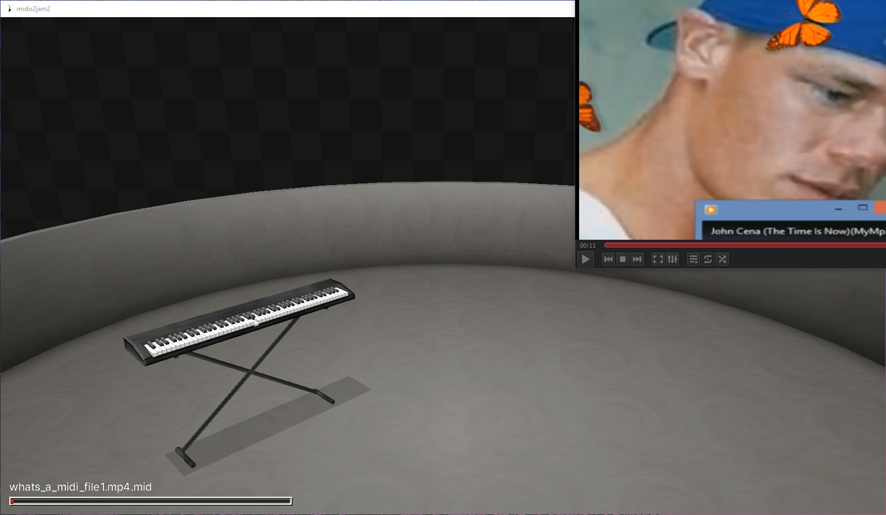

<div align="center" style="text-align: center;">
    <h1>midi-enc</h1>
    
    <p>convert any file type into a midi file with one simple trick</p>
</div>

> [!NOTE]  
> [midi files generated with this program *may* not run on certain midi players](#compatibility)

> [!WARNING]  
> this is not compression by any means.  
> generated files can be way bigger than the original.   
> demo file increased by 9x (1.1 mb -> 8.99 mb).  
> basically, just dont try anything bigger than a few megabytes...  
>  
> also please dont treat this like a secure encryption method..........

## faq

- ### ANY file?  
    yes! files are just bytes, this program just puts those bytes in a format that midi players can understand.
- ### can i convert existing midis?
    sadly not right now, but i am planning to implement it once i figure how to do multi-track encoding

## how to install

### run file
1. download the `main.py` file
2. run `python main.py` with flags and args

### download executable
1. download the midi-enc executable in releases
2. run `midi-enc` with flags and args

### build
1. clone this repository
2. run `pip install -e .`
2. run `midi-enc` with flags and args

## usage

```
args: --encode (-e), --decode (-d), --output (-o), --inst (-I), --delta (-l)
```

### file -> .mid
```
midi-enc -e (file) # will return filename.type.mid

midi-enc -e (file) -o midifile # will return midifile.mid

midi-enc -e (file) -o midifile -I 8 # will return midifile.mid with 8 instruments 

midi-enc -e (file) -o midifile -I 8 -l 100 # will return midifile.mid with 8 instruments with a note delta time of 100 ms
```

### .mid -> file
```
midi-enc -d (midi) # will return filename.type

midi-enc -d (midi) -o name # will return name ***you must provide type!!***
```

as an example, try to decode the `decode-me.txt.mid` file in the repo!

## compatibility

<div align="center">
<h3><i>compatibility does not guarantee fast loading or playback</i></h3>
<p>✅: yes ❔: idk ❌: no</p>

| platform | compatibility |  
|----------|---------------|
| midis2jam2 | ✅ (on the latest version)
| most web players | ✅
| midijam | ❔
| VLC | ❔
|windows media player| ❌|  
</div>


<hr>
<div align="right"><i>made for hack club's <a href="https://crescent.hackclub.com/">crescent</a> </i></div>
